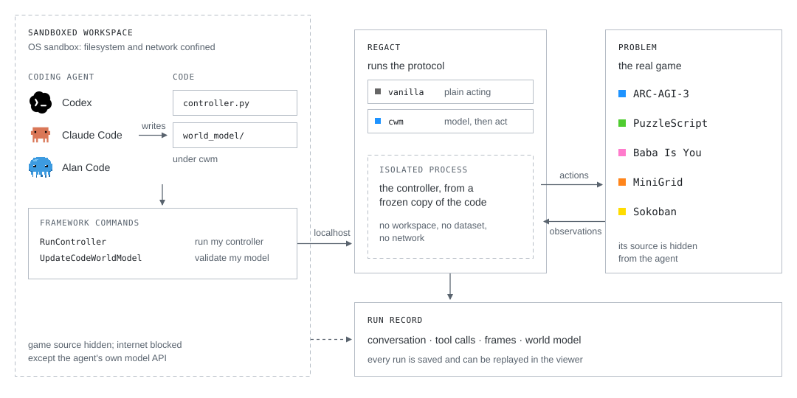
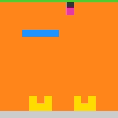
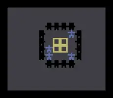
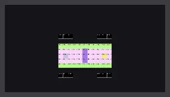
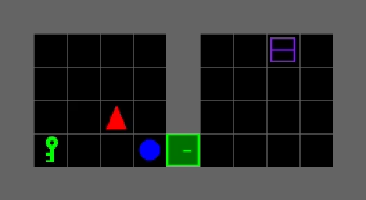
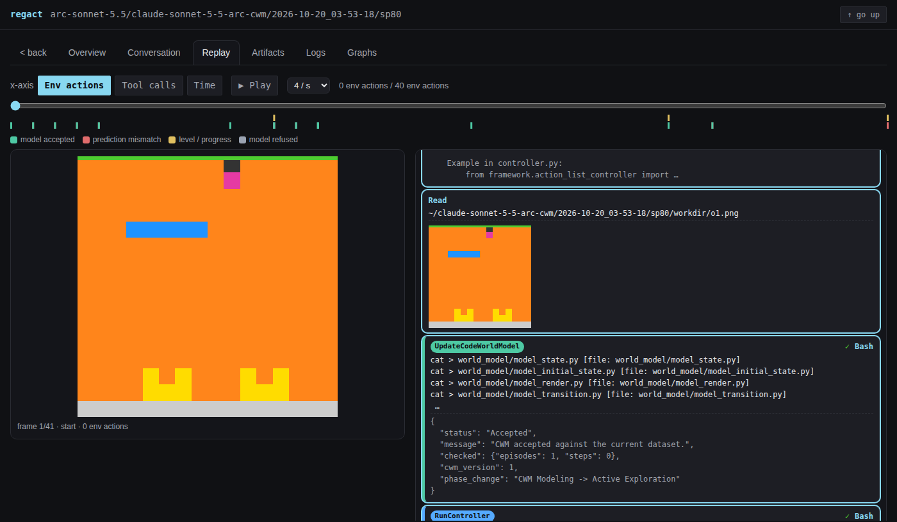
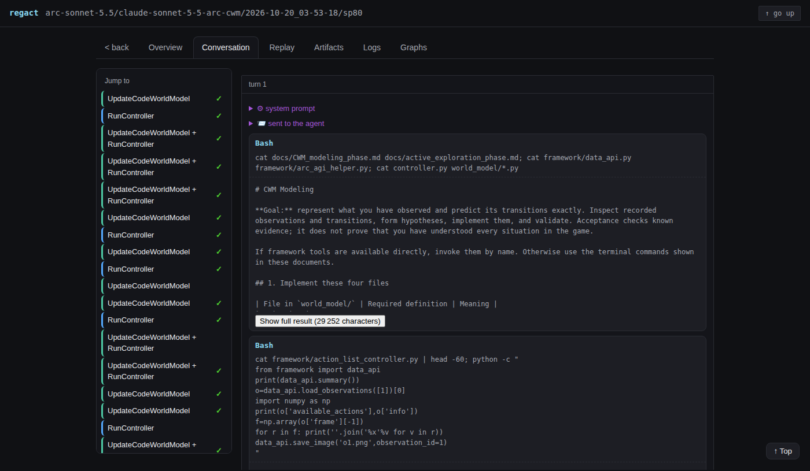
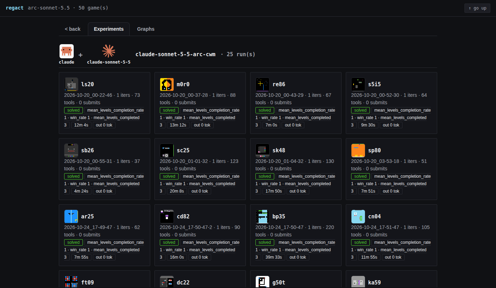
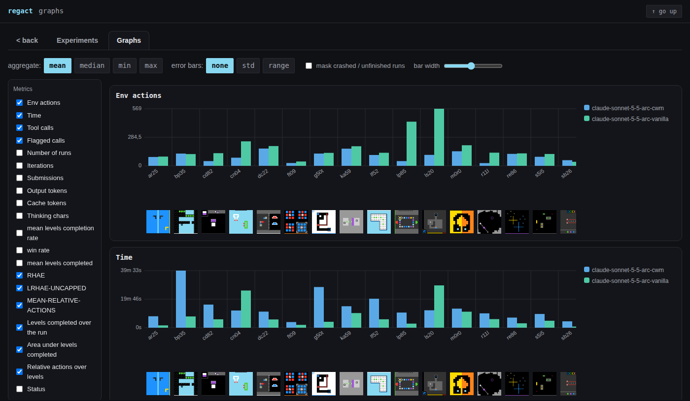

<div align="center">

# regact

**Reasoning · Game · Act**


</div>

---

**regact** runs coding agents on games they have never seen. The agent (Claude Code, Codex, Alan Code, ...) gets an unknown game, a sandboxed workspace and a controlled way to play: it writes Python controllers, the framework runs them against the real game, and the agent reads back what happened. The agent, the game and the experiment protocol are separate, interchangeable parts, so the same setup compares agents, models and protocols. Every run is recorded and can be replayed in a viewer: **[watch some benchmark runs online](https://timotheboulet.com/viewer/)**.

<p align="center">
  
</p>

## Games

<table align="center">
  <tr>
    <td align="center"><br><sub>ARC-AGI-3</sub></td>
    <td align="center"><br><sub>PuzzleScript</sub></td>
    <td align="center"><br><sub>Sokoban</sub></td>
  </tr>
  <tr>
    <td align="center" colspan="2"><br><sub>Baba Is You</sub></td>
    <td align="center"><br><sub>MiniGrid</sub></td>
  </tr>
</table>

<p align="center"><sub>Each clip is the end of a solved run, all under the <code>cwm</code> protocol (Claude Sonnet 5.5 or Haiku 5.5).</sub></p>

| `problem=` | Game | Install |
|---|---|---|
| `arc_agi` | the [ARC-AGI-3](https://arcprize.org) games | `make install-arc` |
| `puzzlescript` | games from the [PuzzleScript](https://www.puzzlescript.net) gallery, original engine ([page](docs/envs/puzzlescript.md)) | Node, `make install-puzzlescript` |
| `babaisyou` | the campaign levels of *Baba Is You*, worlds 0-9 ([page](docs/envs/babaisyou.md)) | `make install-babaisyou` |
| `minigrid` | [MiniGrid](https://minigrid.farama.org/) and BabyAI; `problem=minigrid_cwm` is a deterministic set ([page](docs/envs/minigrid.md)) | `make install-minigrid` |
| `sokoban` | packs of Boxoban levels ([page](docs/envs/sokoban.md)) | nothing |

The level-based games share ARC's conventions: RESET is a game action, completing the last level wins, and efficiency is measured against an optimal player (ROAE), as ARC measures it against a human one (RHAE). See [Environments](docs/environments.md).

## Protocols

The protocol decides what the agent is asked to produce and which framework commands it gets.

| `protocol=` | The agent |
|---|---|
| **`vanilla`** | reads its recorded experience, writes a controller and runs it in the real game (`RunController`), as often as its budget allows. |
| **`cwm`** | must first write a **Code World Model** that reproduces all its recorded experience (`UpdateCodeWorldModel`); every action of its controllers is then checked against the model's prediction, and a contradiction sends it back to modeling. |

Both protocols share the environment management, the dataset API, controller execution and the limits, so a comparison measures the effect of requiring a validated world model and nothing else. Controllers run in a separate process from a frozen copy of the agent's code, without access to the workspace, the recorded data or the network. With `problem.lifecycle=single_instance` the game stays live across controller calls; `multi_instance` resets it before each call. See [Protocols](docs/protocols.md), [Managed execution](docs/managed_protocols.md) and [CWM](docs/cwm.md).

## Agents

| `agent=` | What it is |
|---|---|
| `claude` | the Claude Code CLI |
| `codex` | the Codex CLI |
| `alan` | [Alan Code](https://github.com/tboulet/Alan-Code-agent), also against open-weight models served through an OpenAI-compatible endpoint |
| `antigravity` | Google's Antigravity CLI (`agy`) |
| `scripted` | a deterministic backend for tests, no LLM |

The agent is independent of the protocol: any agent runs any protocol, with any model it supports. Setup for each: [Agents](docs/agents.md).

## Install

Python **3.11 or 3.12**.

```bash
python -m venv .venv && . .venv/bin/activate
make install                # core framework + dev tooling (pinned)
make install-arc            # then the games you need (see the table above)
make install-agents         # Alan Code; the claude / codex / agy CLIs install separately
```

Three diagnostics check the machine, each only for what you installed:

```bash
make doctor        # python, agent CLIs, sandbox, game extras
make probe         # does the OS sandbox actually confine here?
make agentcheck    # do the installed agents launch, bare and sandboxed?
```

## Run

A run is composed from config groups picked by name, plus fields overridden on the command line ([`config.yaml`](src/regact/conf/config.yaml)). Always pass `protocol=vanilla` or `protocol=cwm`.

```bash
# Inspect the workspace and prompt a run would get, without starting the agent (no cost):
make run ARGS="agent=claude problem=sokoban protocol=cwm dry_run=true"

# ARC-AGI-3 with Claude Code under cwm, one game:
make run ARGS="agent=claude problem=arc_agi 'problem.tasks=[ls20]' protocol=cwm problem.lifecycle=single_instance limits.max_tool_calls=100"

# Baba Is You with Codex, plain acting:
make run ARGS="agent=codex problem=babaisyou protocol=vanilla limits.max_tool_calls=100 limits.max_seconds_per_task=3600"
```

The main budgets are `limits.max_tool_calls`, `limits.max_seconds_per_task` and `limits.max_actions_per_task`. A launch stops with `make stop RUN_DIR=<run dir>` and continues with `resume=<run dir>`; a backend usage limit ends the task in a resumable state. See [Experiments](docs/experiments.md).

## Viewer

```bash
make viz EXP=experiments          # then open http://localhost:8030
```

Browse the experiments and benchmarks, follow an agent's conversation and tool calls, replay the real trajectory of each controller frame by frame (with the world model's accepted versions and mispredictions under `cwm`), and compare the runs of a benchmark side by side.

| Replay | Conversation |
|---|---|
|  |  |
| **Benchmark runs** | **Benchmark graphs** |
|  |  |

`python -m regact.viz.export` writes a static, read-only copy of the viewer for a website ([Public viewer](docs/public_viewer.md)).

## Documentation

| Guide | What it covers |
|---|---|
| **[Overview](docs/overview.md)** | Architecture, extension points and code map |
| **[Protocols](docs/protocols.md)** | The protocols, lifecycle, adding a protocol |
| **[Managed execution](docs/managed_protocols.md)** | Controllers, resets, the dataset API and the shared parameters |
| **[CWM](docs/cwm.md)** | Modeling, validation, exploration and planning under `cwm` |
| **[Environments](docs/environments.md)** | The games, grid games, adding a game |
| **[Agents](docs/agents.md)** | Using and adding an agent |
| **[Experiments](docs/experiments.md)** | Launching, stopping and resuming runs, outputs, HPC |
| **[Sandboxing](docs/sandboxing.md)** | How isolation works and how it is verified |
| **[Public viewer](docs/public_viewer.md)** | Exporting the viewer as a static site |

## Development

```bash
make check         # ruff + mypy + unit tests
make test-all      # every test, including the live ones (needs alancode / a game)
```
